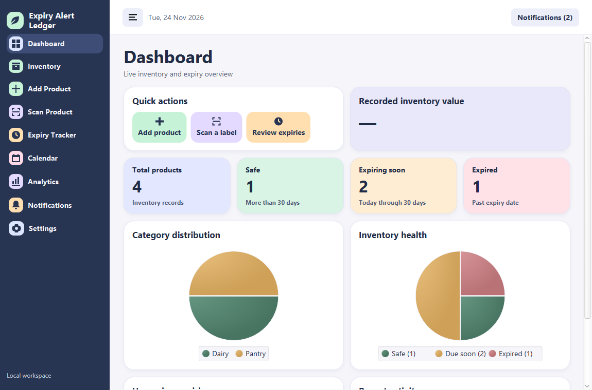
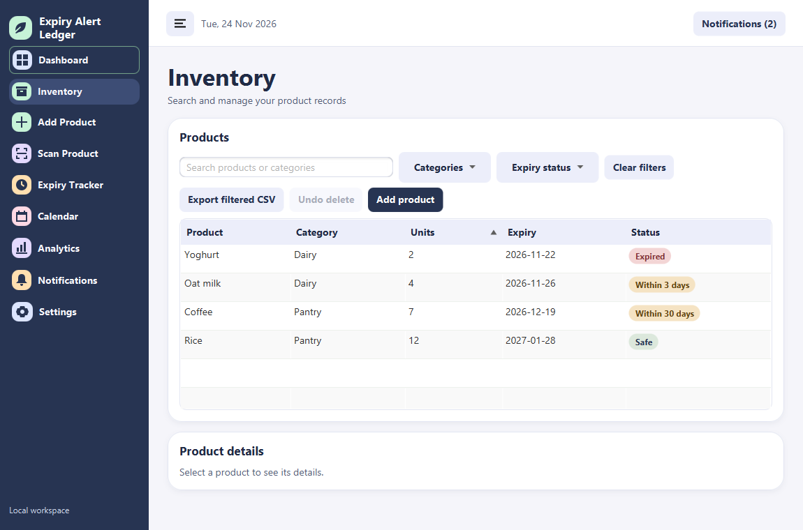

# Expiry Alert Ledger

A JavaFX workspace for recording inventory, tracking expiry dates and deciding which stock needs attention. The design takes inspiration from the reference workspace navigation, summary cards and expiry queue. [Reference dashboard](https://inventoryjavaproject.vercel.app/) The desktop application works with the original CSV inventory and with an optional H2 database. The JPro profile serves the same JavaFX screens over WebSockets.





## Features

- Dashboard metrics and charts calculated from inventory records, with quick actions, upcoming expiries and recent changes from the current session.
- Product CRUD, detail view, name and category search, sortable columns, combined category and expiry filters, CSV reports and undo for the latest deletion in the current session.
- Six expiry bands, countdowns and an interactive month calendar. Dates are recalculated when the host day changes.
- JavaFX category, health, quantity and expiry-date charts. The monthly series counts the expiry dates on current records. Unit prices are optional and totals use the currency entered by the inventory owner.
- Label OCR with Tesseract, an editable preview, validation, and explicit confirmation before saving.
- Configurable expiry reminders, persistent read state and workspace preferences, keyboard shortcuts and reduced motion.

## Desktop

Install a JDK and Maven 3.9. The desktop source targets Java 17 and uses JavaFX 21.0.5. Open a terminal in this directory.

```powershell
mvn test
mvn javafx:run
```

Use a separate terminal to run the console application.

```powershell
mvn compile exec:java
```

The supplied data/inventory.csv stays in the unpacked project. An existing six-column CSV upgrades on the first successful write. The database backend upgrades an existing H2 items table in place. Back up data before opening it in the new version. If switching from CSV to a new H2 database, first run in CSV mode and save a record to create the Java serialization snapshot. Then switch on JDBC. An uninitialized database can restore the snapshot. Keep one desktop, console or legacy server writer per data store.

```powershell
$env:LEDGER_STORAGE = 'jdbc'
$env:LEDGER_DB_URL = 'jdbc:h2:./data/inventory'
mvn javafx:run
```

The optional LEDGER_DB_USER and LEDGER_DB_PASSWORD variables supply H2 credentials. Use Remove-Item Env:LEDGER_STORAGE to switch back to the default CSV backend. New installations without a CSV or a snapshot use the original starter records. A saved empty inventory stays empty.

For desktop OCR, install Tesseract 5 with English trained data and make its executable available on PATH. On Windows you can set the executable explicitly before launching.

```powershell
$env:LEDGER_TESSERACT = 'C:\Program Files\Tesseract-OCR\tesseract.exe'
mvn javafx:run
```

The label parser accepts ISO and day-first dates with a visible expiry or manufacture label. Review all OCR fields, especially dates. A missing executable, unreadable image or empty OCR output displays an error and creates no product. [Tesseract installation documentation](https://tesseract-ocr.github.io/tessdoc/Installation.html)

## JPro browser mode

Use JDK 25 with Maven and set JAVA_HOME to that JDK. The browser profile compiles for Java 22 against JavaFX 24.0.2. JPro 2026.3.0 bundles its patched JavaFX runtime in the release. Build desktop and browser profiles with a clean target when switching between them. JPro Maven coordinates are resolved from JPro's Maven repository. [JPro documentation](https://github.com/JPro-one/JPro-Documentation)

```powershell
$env:LEDGER_BROWSER_DATA = Join-Path $PWD 'browser-data'
mvn clean
mvn -Pjpro "-Dledger.port=8080" jpro:run
```

Open http://localhost:8080/ and create a private workspace. Save the generated workspace key to reopen it. Each workspace has a dedicated H2 database and preferences under LEDGER_BROWSER_DATA. The server stores a SHA-256 digest of the generated key as the directory name. A workspace key is a bearer credential with no password recovery. One browser session at a time may hold a workspace's write lock. The server releases that lock when the JPro session closes. Browser and desktop data paths are independent.

PNG and JPEG uploads use the JPro file picker. On the server Tesseract processes the image, and the browser receives the JavaFX review form. The JPro release also supports triggering a browser CSV download. Camera capture is outside this version. On devices that offer the camera through their browser or operating-system file picker, a photo can be selected as an image.

For a packaged host release, build on the target platform or set -Dledger.release.platform=linux for Linux x86-64:

```bash
mvn -B -Pjpro -DskipTests jpro:release
```

## Deploy the free Render demo

[Open the Render deployment setup](https://render.com/deploy?repo=https%3A%2F%2Fgithub.com%2Fsukhritibhangu%2FExpiryManagement%2Ftree%2Fcodex%2Fjavafx-ledger-upgrade)

Sign in to Render and review the Blueprint. It defines one Free Docker web service, with no disk or database add-on. Once the service is live, open the onrender.com URL shown on its dashboard. [Render free tier](https://render.com/docs/free)

The browser demo uses temporary H2 workspaces. Inventory and keys created in the demo reset when Render restarts, redeploys or spins down the service. The original desktop data stays on your computer. Render may take about a minute to wake the demo after inactivity.

JPro lists educational use as free for eligible students and teachers who apply. Confirm the issued licence covers the public demo before publishing. Windows Application Control blocked local JPro startup, so verify the browser workflow on Render after deployment. [JPro pricing](https://www.jpro.one/pricing)


## Architecture and Java concepts

| Package | Responsibility |
| --- | --- |
| model | InventoryEntry inheritance, Item encapsulation, Expirable interface, LocalDate and expiry bands |
| service | Inventory use cases, expiry calculation and label OCR process orchestration |
| storage | Repository abstraction, CSV file I/O, Java serialization and prepared JDBC statements |
| gui | JavaFX controls, event handlers, generic lists and table transformations, charts and background Tasks |
| animation | Reusable JavaFX animation routines |
| config | Preferences, persistent workspace keys and exclusive workspace leases |
| browser | JPro-specific startup and file handling |
| app, util, web | Original Java console entry point, password hashing, logging and local-only legacy server |

The code demonstrates object creation, overloaded constructors and methods, polymorphism through the repository interface, generics, collections, exception handling, multithreading, lambdas, logging, serialization, JDBC, ChronoUnit and event-driven JavaFX.

The original HTML/JavaScript dashboard is retained for local legacy use. The JPro deployment uses the JavaFX application and excludes those files. Legacy local profile passwords migrate to salted PBKDF2 after a successful login. The legacy API is loopback-only and its profile is separate from browser workspaces.

## Tests and limits

```powershell
mvn test
mvn "-Dledger.fx.test=true" test
```

The desktop interaction test requires a graphical session. Set LEDGER_TESSERACT before running the tests to include real OCR extraction. Core regression coverage includes backwards-compatible CSV and H2 data, repository persistence, save failures, exact expiry boundaries, workspace isolation, password hashing and notification preferences. The desktop test covers navigation, inventory CRUD, filters, sorting, charts, calendar, notifications, export and the scanner's failure path.

Reminder history and user preferences persist. Recent dashboard activity and delete undo are session-scoped. The monthly charts derive from expiry dates on current records because the original storage has no historical event table.
